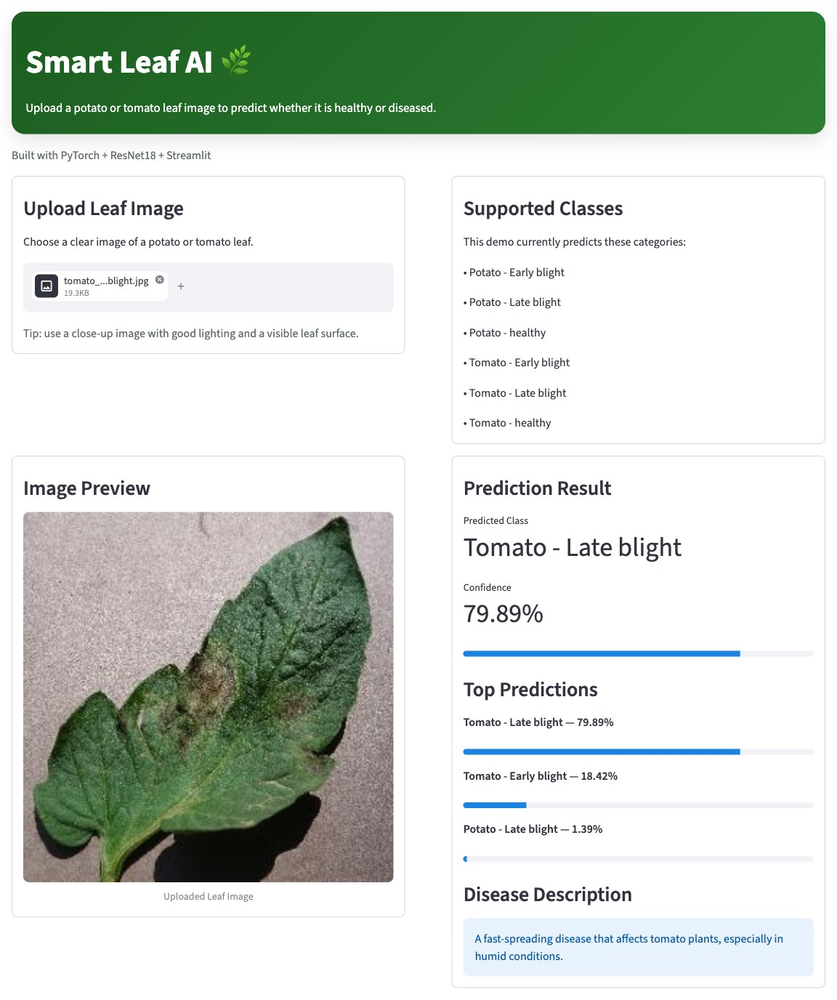

# Smart Leaf AI

Upload a photo of a potato or tomato leaf and get the disease back in about a second.
A ResNet18 model fine-tuned on PlantVillage, served with Streamlit.

[](https://smart-leaf-ai-j3iislqqio8qgaoft7adbk.streamlit.app/)


[](LICENSE)

**[Try the live demo](https://smart-leaf-ai-j3iislqqio8qgaoft7adbk.streamlit.app/)**
<sub>(the free host puts the app to sleep when nobody uses it, so the first load can take a minute)</sub>



## What it does

- Takes a JPG or PNG of a single leaf
- Predicts one of six classes and shows the confidence
- Lists the top three predictions, so you can see when the model is unsure
- Gives a short description of the disease

| Plant | Classes |
|---|---|
| Potato | Early blight, Late blight, Healthy |
| Tomato | Early blight, Late blight, Healthy |

## Results

Trained on 6,652 PlantVillage images, split 70 / 15 / 15 into train, validation and test sets.

| Split | Images | Accuracy |
|---|---:|---:|
| Validation | 997 | 94.18% |
| Test | 999 | **93.69%** |

How it was trained:

- ResNet18 pretrained on ImageNet. The backbone is frozen and only the final layer is trained.
- Input 224 × 224, with random flips, rotation (±15°) and colour jitter on the training set
- Adam, learning rate 0.001, batch size 32, 5 epochs
- The weights from the epoch with the best validation accuracy are kept

The full training run, with outputs, is in [`notebooks/plant_leaf_disease_classification_training.ipynb`](notebooks/plant_leaf_disease_classification_training.ipynb).

## Run it locally

```bash
git clone https://github.com/spneoarm/smart-leaf-ai.git
cd smart-leaf-ai
python -m venv .venv
source .venv/bin/activate        # Windows: .venv\Scripts\activate
pip install -r requirements.txt
streamlit run app.py
```

Then open http://localhost:8501. The trained model (`models/leaf_model_final.pth`, 45 MB) is already in the repo, so you do not need to train anything.

## Train it yourself

1. Download the [PlantVillage dataset](https://github.com/spMohanty/PlantVillage-Dataset) and keep the six potato and tomato folders listed above.
2. Open the notebook in Google Colab and set `dataset_path` to your copy.
3. Run all cells. The notebook saves a new `.pth` file. Copy it to `models/leaf_model_final.pth`.

The app expects the classes in alphabetical folder order, which is the order `ImageFolder` uses.

## Project structure

```text
smart-leaf-ai/
├── app.py              # Streamlit app: loads the model and runs predictions
├── models/
│   └── leaf_model_final.pth
├── notebooks/
│   └── plant_leaf_disease_classification_training.ipynb
├── docs/
│   └── demo.jpg        # screenshot used in this README
├── requirements.txt    # Python packages
└── packages.txt        # system packages for Streamlit Community Cloud
```

## Limitations

- PlantVillage photos are taken in a lab, one leaf on a plain background. Photos from a real field, with soil, shadows or many leaves, will be less accurate.
- The model always picks one of the six classes. A photo of any other plant, or of something that is not a leaf, still gets a label, so check the confidence.
- The split uses a single random shuffle with no fixed seed, so a new training run will give slightly different numbers.
- This is a learning project, not a tool for real crop decisions.

## Credits

- Dataset: PlantVillage. Hughes, D. P., and Salathé, M. (2015). *An open access repository of images on plant health to enable the development of mobile disease diagnostics.* [arXiv:1511.08060](https://arxiv.org/abs/1511.08060)
- Model: ResNet18 from [torchvision](https://pytorch.org/vision/stable/models.html)

## License

The code is released under the [MIT License](LICENSE).
